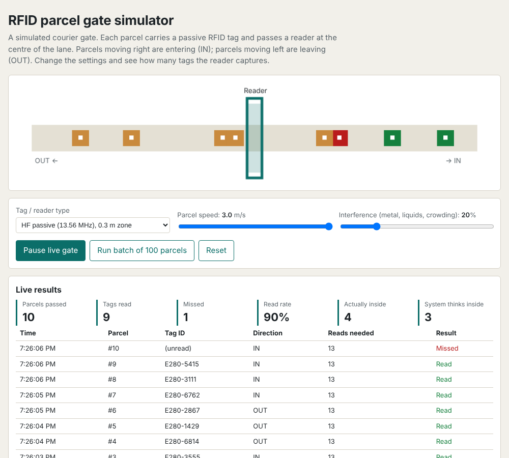
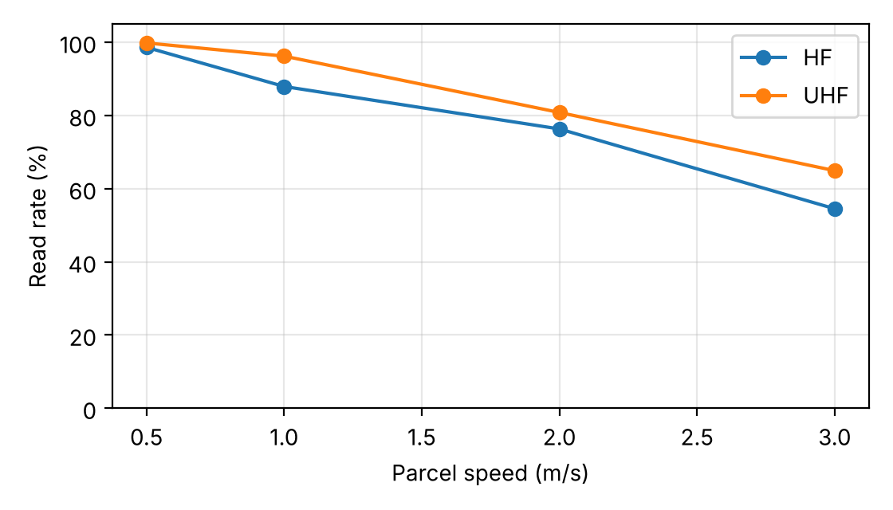
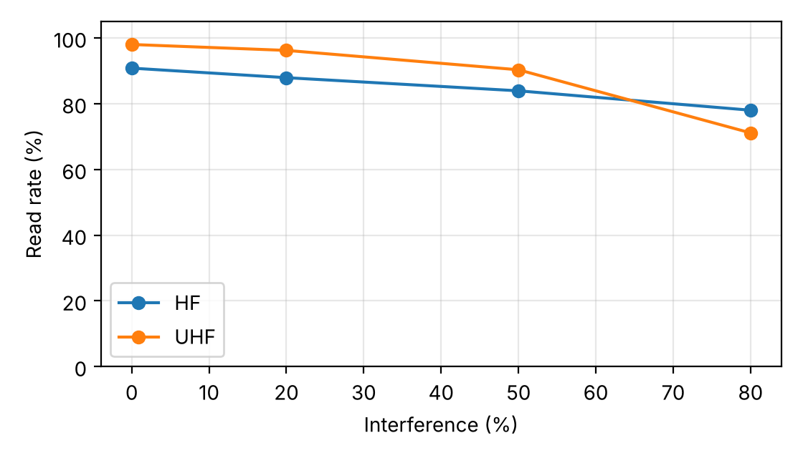

# RFID Parcel Gate Simulator

[](../../actions/workflows/tests.yml)

A small simulation of an RFID tracking gate for a courier or company entry and exit point. Parcels carrying passive RFID tags pass a reader in both directions (**IN** and **OUT**). The simulator shows how **parcel speed**, **interference** and the **reader type (UHF vs HF)** change how many parcels are captured, and how missed reads make the system's parcel count drift away from the real one.

It started as a university lab exercise on optimizing wireless networks with RFID tracking technology (Riara University, RBCS7311).



> **Important:** this is a model, not a measurement. The reader settings are assumptions chosen to show realistic trends (UHF has a longer range but is more affected by its surroundings than HF). Real hardware must be tested before drawing real conclusions.

## Two ways to use it

**1. Web demo (no install).** Open `docs/index.html` in a browser. It animates the gate, shows a live scan log and lets you run batches of 100 parcels. To host it, turn on GitHub Pages for the `docs/` folder in the repository settings.

**2. Python command line.**

```bash
pip install -e .                 # add ".[plot]" for charts, ".[test]" for tests
rfidgate batch --tag uhf --speed 1 --interference 0.2 --parcels 1000 --seed 1
rfidgate sweep --vary speed --csv speed.csv --plot speed.png
rfidgate sweep --vary interference --seed 2026
rfidgate live --tag hf --speed 2 --parcels 15
```

Use `--seed` for repeatable results. `python -m rfidgate ...` also works. Python 3.9 or newer, no dependencies (matplotlib only for `--plot`).

## How the model works

While a tag is inside the reader's zone, the reader makes repeated read attempts.

- **Attempts** = `max(1, round(reads_per_second x zone_length / speed))`
- **Chance per attempt** = `base_success x (1 - interference x sensitivity)`
- A parcel is **read** if any attempt succeeds, so the exact read rate is `1 - (1 - p) ^ attempts`. The tests check that the simulation matches this formula.
- Each missed parcel changes the true number of parcels inside but not the system's count. The gap is the **count error**.

| Setting | UHF (860-960 MHz) | HF (13.56 MHz) |
|---|---|---|
| Read zone length | 1.5 m | 0.3 m |
| Read attempts per second | 25 | 10 |
| Success chance per attempt (no interference) | 10% | 55% |
| Sensitivity to interference | 0.85 | 0.35 |

Edit the two `ReaderProfile` lines in `src/rfidgate/model.py` to try your own values.

## Example results

1,000 simulated parcels per row, seed 2026 (`examples/*.csv`).

**Effect of parcel speed (20% interference)**

| Reader | Speed (m/s) | Parcels | Read | Missed | Read rate |
|---|---|---|---|---|---|
| UHF | 0.5 | 1000 | 998 | 2 | 99.8% |
| UHF | 1 | 1000 | 962 | 38 | 96.2% |
| UHF | 2 | 1000 | 808 | 192 | 80.8% |
| UHF | 3 | 1000 | 649 | 351 | 64.9% |
| HF | 0.5 | 1000 | 986 | 14 | 98.6% |
| HF | 1 | 1000 | 879 | 121 | 87.9% |
| HF | 2 | 1000 | 763 | 237 | 76.3% |
| HF | 3 | 1000 | 545 | 455 | 54.5% |



**Effect of interference (speed 1 m/s)**

| Reader | Interference | Parcels | Read | Missed | Read rate |
|---|---|---|---|---|---|
| UHF | 0% | 1000 | 980 | 20 | 98.0% |
| UHF | 20% | 1000 | 962 | 38 | 96.2% |
| UHF | 50% | 1000 | 903 | 97 | 90.3% |
| UHF | 80% | 1000 | 711 | 289 | 71.1% |
| HF | 0% | 1000 | 908 | 92 | 90.8% |
| HF | 20% | 1000 | 879 | 121 | 87.9% |
| HF | 50% | 1000 | 839 | 161 | 83.9% |
| HF | 80% | 1000 | 780 | 220 | 78.0% |



What the numbers show:

- Faster parcels spend less time in the zone, so the reader gets fewer attempts. HF is hit hardest because its zone is only 0.3 m long.
- UHF is better in clean conditions, but at heavy interference (80%) HF overtakes it.
- Even a 95% read rate leaves the system's count wrong after a few hundred parcels, so a gate should be backed by spot counts or a second reader.

## Project layout

```
src/rfidgate/model.py     read model: attempts, success chance, exact read rate
src/rfidgate/simulate.py  gate, parcels, batches, sweeps, live events
src/rfidgate/cli.py       command-line interface
tests/                    pytest suite (21 tests)
docs/index.html           browser demo (single file, no dependencies)
examples/                 sample sweep results (CSV)
```

Run the tests with `pip install -e ".[test]" && pytest`.

## Ideas for next steps

- Replace the assumed profiles with measured read rates from a real reader (for example an RC522 on an Arduino or ESP32 for HF, or a UHF reader).
- Add tag orientation, several tags in the zone at once and direction-detection errors.
- Feed real scan logs into the same count-error report.

## License

MIT, see [LICENSE](LICENSE).
